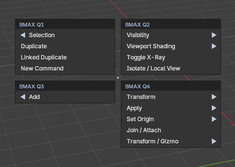

# BMAX Quad Menu v0.1

BMAX Quad Menu 是 Blender 5.3 的四象限浮動選單外掛。在游標附近打開常用工具，依模式切換選單，也可以自己安排指令和快捷鍵。

- **四象限工具選單**涵蓋選取、顯示、物件新增、變形和常用建模指令。
- **子選單**與父項目對齊，滑鼠跨越空隙時會保持展開。
- **自訂指令與快捷鍵**支援直接錄製觸發鍵（包括反引號），並以 JSON 匯入、匯出選單設定。

[下載 Blender 5.3 安裝 ZIP](BMAX_Quad_Menu_Blender53_v0_1.zip) · [繁體中文說明](max_quad_menu/README.md) · [English documentation](max_quad_menu/README.en.md)

BMAX Quad Menu brings common Blender 5.3 tools into a four-quadrant menu at your cursor. It supports mode-specific menus, aligned submenus, shortcut recording, and JSON import and export.
