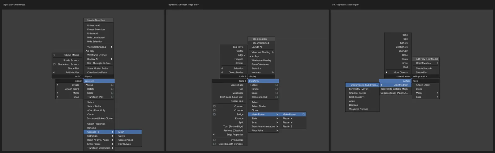

# BMAX Quad Menu

**3ds Max style quad menus for Blender** · [繁體中文說明](README.zh-TW.md)

BMAX Quad Menu brings the 3ds Max quad menu to Blender: four quadrants around the cursor, quad sets on different shortcuts, tools that change with the selection and sub-object level, and the 3ds Max Advanced Quad Menu Options. Every command runs a native Blender operator.

**[⬇ Download v1.1.0](https://github.com/Aomay77/BMAX-Quad-Menu/releases/latest)** · Blender 4.2 or later, built and tested for Blender 5.3

> **Nothing is active after install.** Your Blender menus and shortcuts stay the same until you turn on a quad set and give it a shortcut.

## Features

**Layout like 3ds Max**
- Quad 1 lower right **transform**, Quad 2 upper right **display**, Quad 3 upper left **tools 1**, Quad 4 lower left **tools 2**. The quad titles meet at the cursor.
- **tools 1 / tools 2 follow the context.** Select a light and you get Light Type and Cast Shadows. Select a camera and you get camera tools. In Edit Mesh, the vertex, edge and polygon levels each show their own Editable Poly style tools, such as Weld, Chamfer, Bridge and Inset.
- **Unavailable commands are hidden** and empty quads disappear, as in 3ds Max. You can choose to grey them out instead.

**Quad sets.** Each set has its own shortcut. All sets start switched off, with these 3ds Max shortcuts suggested:

| Quad set | Suggested shortcut |
|---|---|
| Default (transform / display / tools 1 / tools 2) | Right-click |
| Modeling | Ctrl + Right-click |
| Animation | Alt + Right-click |
| Snap | Shift + Right-click |
| Lighting \| Render | Ctrl + Alt + Right-click |
| Custom ×2 | Ctrl + Shift (+ Alt) + Right-click |
| Viewports | V |
| Track View | Right-click in the Dope Sheet, Timeline or Graph Editor |

**Any shortcut.** Click ⏺ **Record** and press any key or mouse button: keyboard keys, numpad, F1–F24, right or middle mouse, mouse buttons 4–7, the wheel, or NDOF buttons, with any Ctrl / Shift / Alt / OS combination. Unused keys such as mouse side buttons or F13–F24 don't override anything. The preferences list every Blender shortcut that a trigger would override.

**Working with the menu**
- **Click a quad title** to repeat the last command used in that quad. The last-used item stays highlighted.
- **Hold, move, release.** Hold the trigger, move onto an item and release to run it.
- **Settings box (□).** Next to a command, it runs the command and opens Blender's *Adjust Last Operation*. Next to Move, Rotate and Scale, it toggles the sidebar, where you can type values (like the 3ds Max Transform Type-In).
- **Interactive tools start where you clicked.** Loop Cut previews and slides on the edge you right-clicked, not where the menu item was. Knife and Extrude work the same way.
- **Check marks** show the state of X-Ray, shading, sub-object level, Auto Key, snapping and so on.
- **Hotkeys** are shown next to commands that have one in Blender.
- **Submenus** open after a short delay. Moving diagonally toward an open submenu doesn't close it.
- **Middle mouse and the wheel** close the menu and navigate the view as usual.
- **Quad View** (Ctrl+Alt+Q) is supported: the menu can span all four views.

**Advanced Quad Menu Options** (same groups as 3ds Max)
- **Colors:** per quad or locked to one set. **Starting Quadrant.**
- **Display:** Uniform Quad Width, Mirror Quads, Vertical Margins, Opacity.
- **Positioning:** Reposition When Off Screen, Move Cursor, Return Cursor.
- **Fonts:** title and menu font size, optional custom font file (useful for CJK text).
- **Animation:** Fade, with Steps and Pause.

## Install

1. Download `BMAX_Quad_Menu_v1_1_0.zip` from [Releases](https://github.com/Aomay77/BMAX-Quad-Menu/releases/latest). Don't unzip it.
2. Blender → **Edit → Preferences → Add-ons → ▾ (top right) → Install from Disk** → choose the ZIP and enable **BMAX Quad Menu**.
3. Go to **Quad Sets**, pick a set, click **⏺ Record** and press your shortcut. The set turns on.

**Updating from v0.0.x or v0.1:**
- Disable and remove the old add-on first.
- On first start, your old `menus.json` is imported automatically. Each page becomes its own quad set, named *Imported · page*, with its old shortcut, switched off. The old file is not changed.
- You can import an old file again from **Import old menus.json**.

## Editing menus

Go to **Preferences → BMAX Quad Menu → Menu Editor**, or open the 3D View sidebar → **BMAX Quad** tab.

1. Choose the **quad set** and **mode** (Object, Edit Mesh, … or *Global* as the fallback). Then click one of the four quad buttons.
2. Add a **command**, **toggle**, **submenu**, **dynamic submenu** or **separator**. You can also remove, duplicate, reorder, enter submenus or move items to another quad.
3. **Quickest way to add something:** right-click any Blender button → **Add to BMAX Quad**. Property buttons, such as X-Ray or snapping, become toggles with a check mark.
4. **From the clipboard:** right-click a button → **Copy Python Command**, then press 📋 in the editor. The text is parsed, never executed.
5. **Show When** limits an item to object types, a selection, isolate mode, or a mesh sub-object level.
6. Any single item can also have its own shortcut.

Settings are saved automatically to `bmax_quad_menu/bmax_quad.json` in Blender's config folder. In the preferences you can also:
- **Save As / Load** to back up or share a setup.
- **Restore Missing Defaults** to add back built-in items. It never changes or deletes your own.
- **Reset to 3ds Max Defaults**, which writes a backup first.

## Status

v1.1.0 was tested headless in Blender 5.3, and all tests pass:
- Every built-in command, parameter, tool and property path exists in Blender 5.3.
- Context switching and check marks are correct.
- Keymaps are added and removed correctly.
- Save/load round-trips, and old v0.0.x / v0.1 files migrate.
- The preferences UI and editor work.
- The menu draws correctly in an offscreen render; the screenshots above come from it.

Some behaviour still needs feedback from real use: mouse interaction in the viewport, the settings box popup, cursor warping (which may not work on Linux Wayland), and shortcut priority against other add-ons. Please [open an issue](https://github.com/Aomay77/BMAX-Quad-Menu/issues) with the System Console output or a screen recording.

See [CHANGELOG.md](CHANGELOG.md) for version history.

*3ds Max is a trademark of Autodesk, Inc. This project is not affiliated with Autodesk; it re-creates the quad menu workflow with Blender's own operators.*
