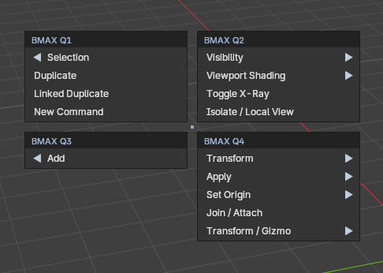

# BMAX Quad Menu v0.1

A quad menu add-on for Blender 5.3. You can carry over your pages, commands, and shortcuts from v0.0.x.

## Install or update

1. In **Edit → Preferences → Add-ons → BMAX Quad Menu**, click **Export JSON** to back up your settings.
2. Disable the old version, choose **Install from Disk** in Preferences, select the v0.1 ZIP, and enable BMAX Quad Menu. Restart Blender if it still shows the previous version.
3. The add-on uses `max_quad_menu/menus.json` in Blender's user configuration directory. Use **Import Edited JSON** if you need to restore your backup.

## Quad menus and the Command Editor

- Q1 and Q3 open submenus to the left when space permits. Q2 and Q4 prefer the right. Near a viewport edge, the submenu can flip or shift.
- When there is room, the first submenu row lines up with its parent row. The submenu stays open as you move the pointer across the gap.
- **Command Editor** filters by the current page, mode, quadrant, and submenu. If **My Page → Global → Top left** is empty, set **Current Page** to **Default** to see the built-in entries. Custom pages can inherit entries from Default in the floating menu.
- To find Loop Cut, use **Edit Mesh → Bottom left → Cut / Divide**. To add missing built-in tools, use **Restore Missing Built-in Defaults (Backup)**.

## Shortcuts

- **Open the quad menu.** Click **Record Trigger** in the add-on preferences, then press your preferred key or combination. The shortcut applies and saves immediately. Right-click to cancel. The default is Ctrl+Shift+Q.
- **Run an individual command.** Select an operator in **Command Editor**, choose a key and modifiers under **Command Shortcut**, then click **Apply Shortcuts**. You can also use **Record Key**. Press Esc to cancel command recording. Select Esc or a standalone modifier from the command key list if you want to assign it.
- Press the backtick key by itself during recording to use **Accent Grave** (`ACCENT_GRAVE`). The command key list includes function keys, number keys, the numeric keypad, arrows, navigation keys, and punctuation supported by Blender 5.3.

## Operator parameters

BMAX uses Blender's native **Adjust Last Operation (F9)**. The BMAX side parameter panel is still pending. Interactive mouse and keyboard behavior and the Loop Cut F9 panel require verification in the Blender window.
