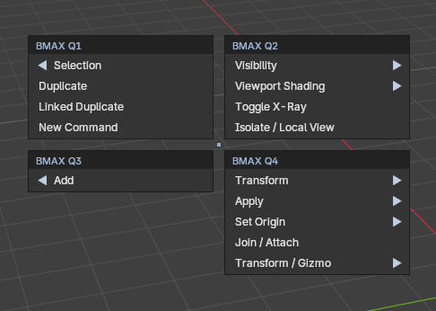

# BMAX Quad Menu v0.1

適用於 Blender 5.3。從 v0.0.x 更新時，可沿用原有的選單頁面、指令與快捷鍵設定。

## 安裝與更新

1. 在 Blender 的 **Edit → Preferences → Add-ons → BMAX Quad Menu** 使用 **Export JSON** 備份設定。
2. 停用舊版，從偏好設定右上角選擇 **Install from Disk**，選取 v0.1 ZIP，再啟用 BMAX Quad Menu。若 Blender 仍顯示舊版，重新啟動 Blender。
3. 原設定檔沿用 Blender 使用者設定目錄下的 `max_quad_menu/menus.json`。如果需要從備份復原，使用 **Import Edited JSON**。

## 四象限子選單

- Q1、Q3 優先向左展開，Q2、Q4 優先向右展開。靠近編輯器邊緣時會換邊或調整位置。
- 有足夠空間時，子選單第一列與父選單觸發列平齊。滑鼠可直接橫移，跨越空隙時會維持展開。滑入下一個項目後，依指向更新選單。
- 如需補回 Loop Cut、Bevel、Inset 等內建工具，使用 **Restore Missing Built-in Defaults (Backup)**。此功能會先備份設定，再補齊缺少的預設項目。

## 在編輯器查看現有指令

**Command Editor** 依目前頁面、模式、象限與子選單篩選。若 **My Page → Global → Top left** 是空的，將上方 **Current Page** 改為 **Default** 即可查看內建項目。自訂頁面可以在浮動選單中繼承 Default 的項目。查找 Loop Cut 時，選擇 **Edit Mesh → Bottom left → Cut / Divide**。

## 設定快捷鍵

- **開啟四象限選單**：在外掛設定頂端按 **Record Trigger**，直接按下想用的按鍵或組合。錄製後立即套用並儲存，按滑鼠右鍵可取消。預設為 Ctrl+Shift+Q。
- **執行單一指令**：在 **Command Editor** 選取 Operator，在 **Command Shortcut** 選擇按鍵與修飾鍵，再按 **Apply Shortcuts**。也可按 **Record Key** 並輸入組合鍵，錄製後會立即套用並儲存。Esc 可取消錄製，若要指派 Esc，請從清單選擇。單獨使用修飾鍵時也請從清單選擇。
- 反引號鍵在 Blender 稱為 **Accent Grave**（`ACCENT_GRAVE`）。錄製時單按反引號即可。指令快捷鍵清單包含 Blender 5.3 的鍵盤事件，包括 F1～F24、主鍵盤數字、數字鍵盤、方向鍵、導覽鍵及符號鍵。
- 指令設定區會顯示偵測到的衝突。如果按鍵已被其他 Blender 功能使用，可在 **Preferences → Keymap** 查看事件分配。

## 驗證

使用 Blender 5.3 背景模式測試快捷鍵註冊、設定讀取與儲存、預設工具目錄及滑鼠路徑邏輯。可在 3D View 開啟 Q3 的 **Object Modes**，橫移滑鼠確認展開狀態。互動式滑鼠操作、實體按鍵與 Loop Cut 的 F9 面板仍需在 Blender 視窗驗證。

本版沿用 Blender 原生的 **Adjust Last Operation（F9）**。BMAX 側邊參數面板尚未加入。
